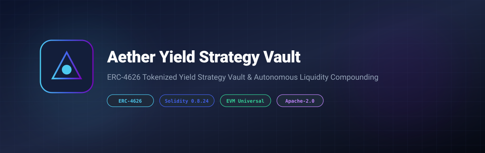

# Aether Yield Strategy Vault



[](LICENSE)
[](https://soliditylang.org/)
[](https://eips.ethereum.org/EIPS/eip-4626)
[](https://www.typescriptlang.org/)

> **An industrial-grade ERC-4626 tokenized yield vault and auto-compounding liquidity protocol deployed across EVM chains.**

---

## 🌟 Overview

The **Aether Yield Strategy Vault** establishes a standardized, composable interface for yield generation protocols. Users deposit underlying assets (such as USDC, WETH, or LRTs) and receive yield-bearing vault shares.

### Key Features
- **ERC-4626 Standard Compliance**: Provides `convertToShares`, `convertToAssets`, `deposit`, and `redeem` entrypoints.
- **Precision Share Accounting**: Prevents rounding attacks through initial seed minting and continuous ratio evaluation.
- **TypeScript Accounting SDK**: Client-side share-to-asset projection and yield accrual simulation tools.

---

## 🚀 Quick Start

```bash
npm install
npm run test
npm run build
```

---

## 📄 License

Licensed under the Apache License, Version 2.0. See [LICENSE](LICENSE) for details.